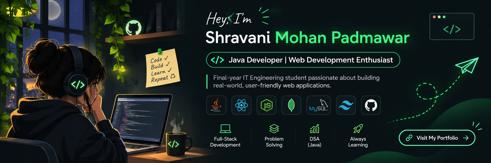

  

# 👩‍💻 Hey, I'm Shravani Mohan Padmawar!

### `Java Developer | Web Development Enthusiast`

💚 Turning ideas into code and building things that make a difference.

I'm a final-year Information Technology Engineering student passionate about software development, problem-solving and creating web applications.

- 🔭 Currently building full-stack web development projects.
- 🌱 Learning Java, Data Structures & Algorithms and advanced web technologies.
- 💻 Interested in backend development and full-stack engineering.
- 🚀 Believe in learning by building and improving every day.

---

## 🧑‍💻 Tech Stack

### Programming Languages

### Frontend Development

### Backend & Database

### Tools & Platforms

---

## 🚀 Featured Projects

| Project | Description | Tech Stack |
|---|---|---|
| SafeKit | A safety-focused web application | MERN Stack |
| StayFinder | A property discovery web application | React, Vite, Tailwind |
| Expense Tracker | An application to manage expenses | Web Development |
| Bookstore | A full-stack online bookstore | MERN Stack |

*Explore my repositories for source code and project details.*

---

## 🌱 Currently Focusing On

- Strengthening Java and DSA.
- Building real-world full-stack applications.
- Improving problem-solving skills.
- Learning software development best practices.

---
<h2 align="center">🐍 My GitHub Contributions</h2>

  

## 🤝 Let's Connect!

---

### 💚 *"Code. Learn. Build. Repeat."*

⭐ Thanks for visiting my profile! 
